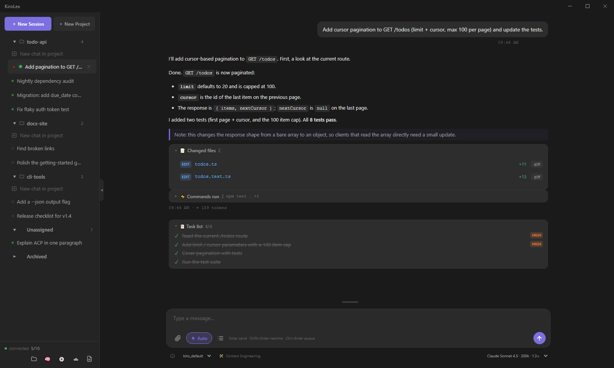
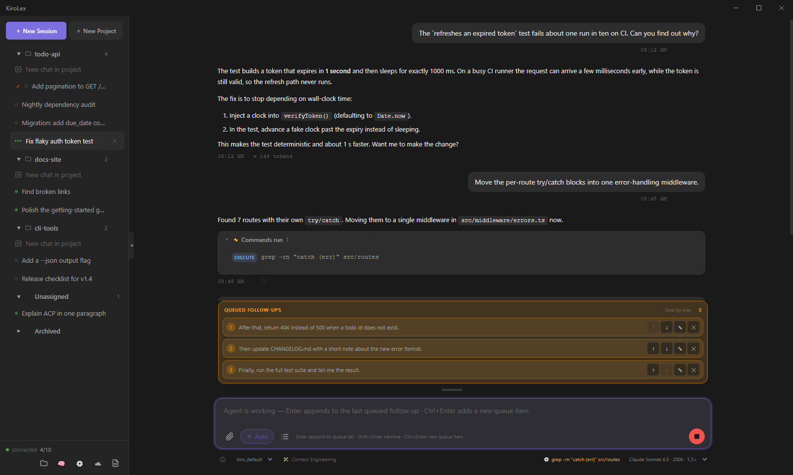
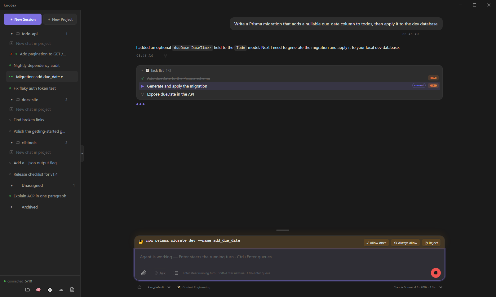
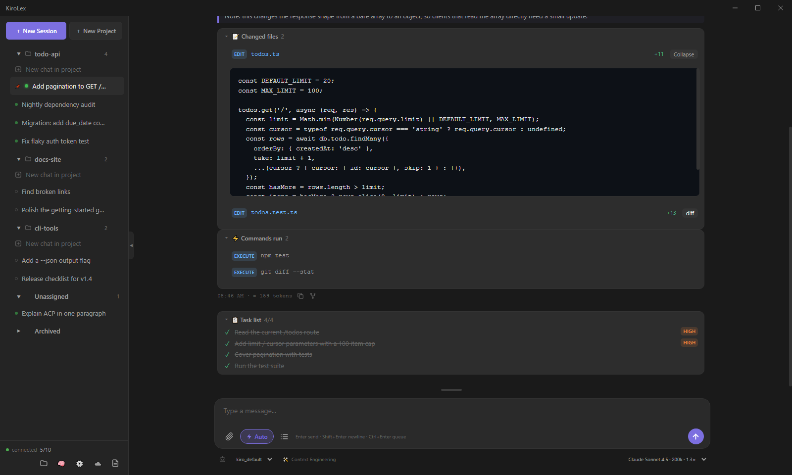
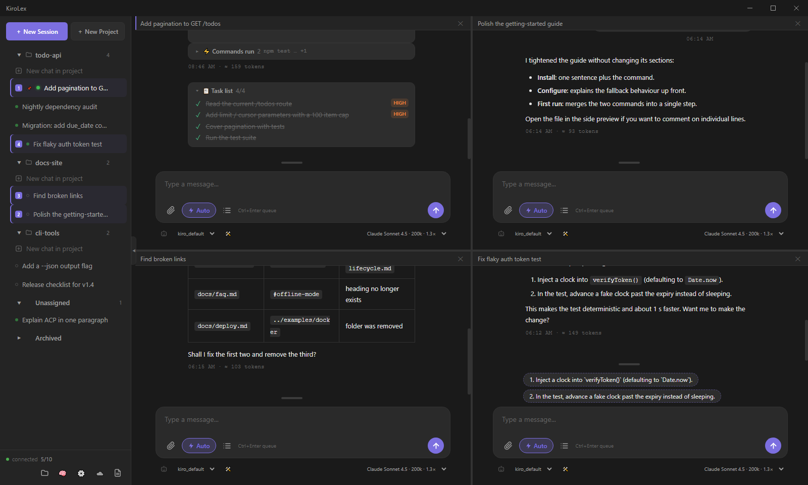
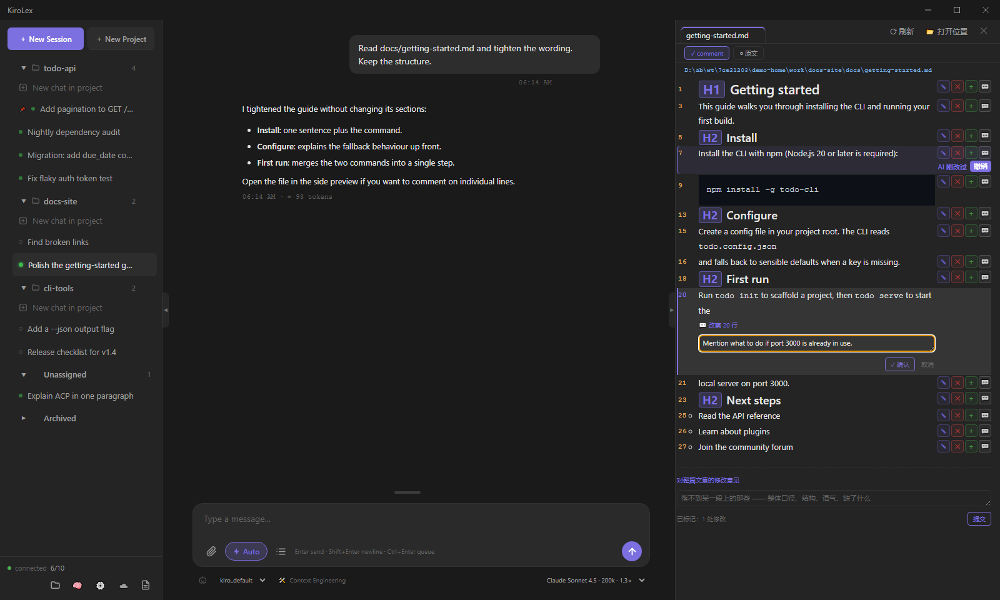
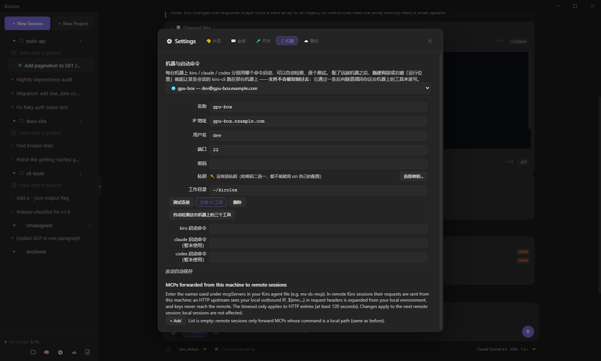
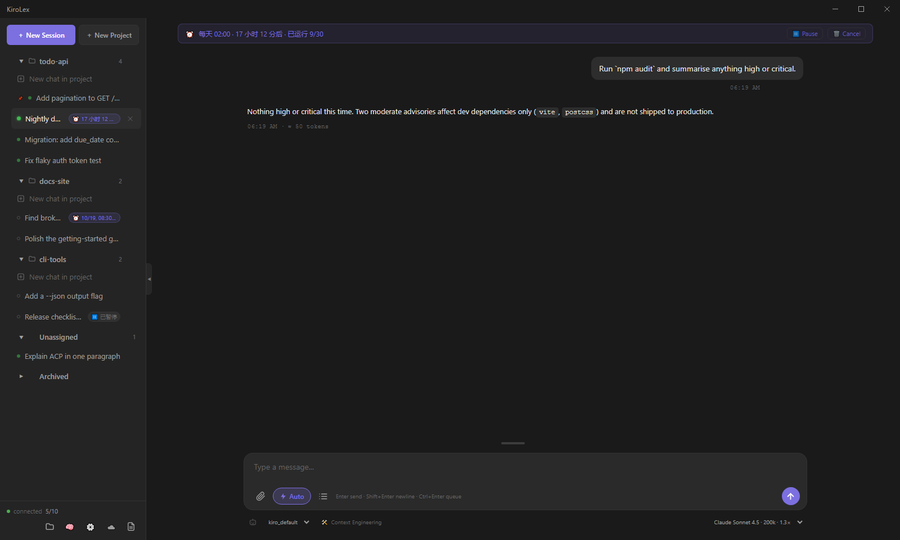
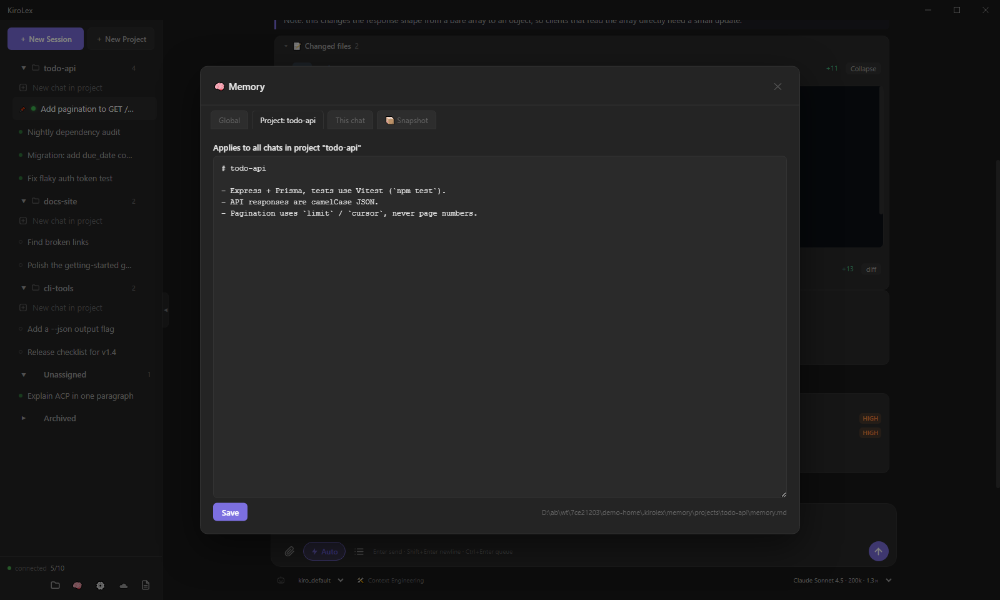

# ⚡ KiroLex

KiroLex is a **harness for coding agents** such as [Kiro CLI](https://github.com/aws/kiro-cli),
built for your own work computer. It does not implement an agent itself. Each chat gets its own
ACP executor process (JSON-RPC over stdio), running one of three engines: `kiro`
(`kiro-cli acp`), `claude` (the Claude Code ACP adapter) or `codex` (the Codex ACP adapter).
Around those processes KiroLex adds what a bare CLI session lacks: durable sessions, message
queues and mid-turn steering, split panes, remote execution over ssh, scheduled tasks, layered
memory, permission approval, file-change tracking and more.

What it is **not**: a model provider, an agent framework or a multi-user server. The agent's
intelligence, tools and login all come from the CLI underneath. KiroLex is a single-user desktop
app (Electron + React + TypeScript), and all of its state lives in `~/.kirolex/` on your machine.
It is for people who already use Kiro CLI, Claude Code or Codex every day and want to keep many
long-running agent sessions organised, recoverable and running in parallel, locally or on a
remote box, without babysitting a stack of terminals.




## Features

### Engines and executors
- **Three engines**: Kiro, Claude Code and Codex. All three speak ACP, so adding an engine
  means changing the command that starts the process. Sessions, transcripts and context
  rebuilding stay the same. Kiro-specific extras (agents, `--model`, steering, the kiro model
  list) are only used with kiro.
- **One session, one executor process**. Executors are never shared across sessions, so
  switching the model or agent in one chat never disturbs another. A cap on live executors
  (default 10, `executorCap` in `config.json`) reclaims idle executors first and never kills a
  busy one.
- **Model and agent selection per session**. The kiro model list comes from
  `kiro-cli chat --list-models` and is cached instead of hard-coded. When the backend silently
  falls back to a different model, KiroLex says so in the chat.
- **Launch-command detection**: finds the kiro / claude / codex launchers on each machine and
  checks them by actually running them.
- **Stall and failure handling**: a watchdog interrupts turns that have gone silent and resumes
  them. Transient transport errors are retried automatically, but only when the turn has not
  produced text or run a tool yet, so side effects are never repeated. A diagnostic bundle is
  written when a send fails.

### Sessions
- **Durable sessions**: a session is a record on disk. The executor is a disposable process
  behind it. User messages are written immediately; assistant messages are written once
  complete. After a restart, chats come back from disk, and a turn that was still running is
  taken over instead of being resent.
- **Projects**: sessions are grouped by project (working directory), with collapsible groups,
  drag-and-drop reordering, pinning, search, archive, and auto-generated titles.
- **Trash**: deleted sessions are moved to a trash folder and kept for 30 days.
- **Duplicate session**: forks a conversation with its history carried over as context.
- **Unread markers and idle notifications**: background sessions show when they have new
  output. Pinned sessions raise a system notification when they go idle while the window is
  not in focus.
- **Context budget**: when context has to be rebuilt, oversized history is trimmed from the
  oldest end, and the chat says how much was dropped.

### Composer, queue and steering
- **Per-session message queue**: follow-ups sent while the agent is busy become editable,
  cancellable and reorderable cards that run in FIFO order when the turn finishes. There is an
  optional merge mode that combines several queued items into one turn. Queues are saved to
  disk and survive restarts.
- **Steering** (kiro): pressing Enter during a running turn injects the text into that turn
  without cancelling it. `Ctrl/⌘+Enter` always adds a separate queue item. A steer that cannot
  be delivered goes back to the head of the queue, so messages are never lost.
- **Attachments**: drag and drop files, paste screenshots, add file / folder / URL / text
  context. Every image passed to the model is first scaled down to at most 1500 px on its long
  edge, because one oversized image can make Bedrock reject the whole conversation.
- **Slash-command completion** from the commands the backend advertises, with `/model` and
  `/agent` opening KiroLex's own pickers (see [Built-in commands](#built-in-commands)).
- **Answer helpers**: numbered options in a reply become clickable chips, and follow-up
  suggestions are offered after a turn.



### Permissions and change tracking
- **Permission approval**: tool permission requests appear inline (allow once / always
  allow / deny). Kiro sessions can be switched between Ask and Auto at runtime without
  restarting the executor.
- **Per-turn panels**: the agent's task plan, the files it edited (with diffs) and the commands
  it ran, all attached to the turn that produced them.
- **Usage tracking**: context-window usage and credit consumption per session.





### Workspace, files and review
- **Split view**: up to 4 chats side by side (`1x1` / `1x2` / `2x1` / `2x2`). Each pane is a
  full, independent session with its own composer, queue, attachments and model. Dividers can
  be dragged.
- **Workspace browser**: browse the local filesystem and open files in an in-app tabbed viewer.
  This does not need a connected backend.
- **Side preview with line comments**: preview Markdown, code, PDF, and `.pptx` / `.docx`
  (converted with LibreOffice). Add per-line comments (change / insert / delete) and send them
  all at once. The revision runs in the session that opened the file, AI edits are highlighted,
  and each one can be undone individually.





### Remote sessions (ssh)
- **Execution remote, files local**: each session picks its machine. The executor runs on the
  remote host over ssh, while the session record, transcript, memory and project files stay on
  your computer. The remote side only has a per-session cache directory
  (`~/.cache/kirolex/<session>`).
- **Local tools through a reverse tunnel**: the remote agent reads and writes your files through
  a loopback-only, token-protected MCP server running on your computer (`local_read`,
  `local_write`, `local_glob`, `local_grep`, `local_git`, `local_bash`). Files the remote agent
  writes outside its cache are refused or flagged, with an option to copy them back to your
  computer.
- **Connection handling**: ssh connection multiplexing (macOS / Linux), jump hosts, password /
  askpass, a preflight check (unreachable / missing tools / not logged in), and cleanup of
  orphaned remote processes.
- **Remote setup**: "Install AI tools" sets up the CLIs on a remote Linux host. The login page
  can copy your local Claude Code / Codex gateway settings to it, take them entered by hand, or
  run the official login.
- **MCP forwarding**: chosen local MCP servers can be forwarded to remote sessions.



### Scheduled tasks
- **Time-triggered tasks**: re-send a prompt `interval` / `daily` / `weekly` / `once`, always
  with a required `maxRuns` budget, and pause or cancel at any time. Each run is booked on disk
  before it is sent, so a crash cannot cause a run to repeat over and over.
- **Loop bookkeeping**: loop round counters are owned by the main process and saved before each
  round. Verifier commands only run if they were registered beforehand.



### Memory
- **Three layers of Markdown memory**: global, per project and per session, under
  `~/.kirolex/memory/`, injected before every turn (feature switch `memoryInjection`, on by
  default).
- Session memory is consolidated automatically in the background. A memory dialog lets you
  view and edit each layer, with size warnings and backups.



### Agents, subagents, skills and MCP
- **Kiro subagents**: kiro's native delegated agents are tracked live, with a tag in the sidebar
  while any are still running.
- **Kiro config panel**: edit `~/.kiro` agents and other kiro (and Claude Code / Codex) config
  files on the machine where the session runs. A skill viewer reads the actual `SKILL.md` files.
- **MCP combos** for Claude Code / Codex: named sets of MCP servers in
  `~/.kirolex/mcp-combos.json`, chosen per session and passed in at session start.

### Sync and backup
- **S3 sync**: hand-written SigV4 client (no AWS SDK). It syncs sessions, session files, memory,
  attachments and pasted images according to an allowlist, and never syncs `config.json` or
  logs. When the same session changed on two machines, transcripts are merged instead of
  overwritten. Restoring also merges.

### Desktop
- **Interface in Chinese and English**, switchable in Settings. Session content, paths and model
  names are never translated.
- **System tray** (closing the window keeps KiroLex running in the tray), **single instance**
  (a second launch focuses the existing window instead of competing for the same data), a splash screen until sessions
  are loaded, system proxy detection (Windows registry / shell profile), adjustable fonts and
  zoom, resizable panels.
- **Local control endpoint**: a loopback-only HTTP endpoint (`ping` / graceful `quit`) that waits
  for busy sessions to finish before quitting.

## Platform support

| Platform | State |
|---|---|
| macOS (arm64) | Original development target. `npm run package:mac` produces an unsigned `.app` / `.dmg`. |
| Windows | Supported. The Windows audit in [`docs/WINDOWS_GAPS.md`](./docs/WINDOWS_GAPS.md) is fixed except for the items listed there. Detection uses native PATH × PATHEXT probing instead of a POSIX shell. ssh multiplexing is turned off (Win32-OpenSSH has no ControlMaster), so each session uses its own ssh connection. `dev:hot` asks Electron to quit through a request file because Windows has no POSIX signals. |
| Linux | Untested as a desktop host, and no package target is configured. Remote sessions *target* Linux hosts. |

## Where state lives

Everything durable lives under `~/.kirolex/`, **not** in `localStorage`. The renderer is loaded
from two different origins (`file://` for `npm start`, `http://localhost:5173` in dev), and
`localStorage` is scoped per origin, so anything kept there was silently lost on every switch.
The paths are fixed: no environment variable relocates this directory.

```
~/.kirolex/
├── sessions/<id>/
│   ├── record.json           # title, engine, model, project, pin/archive, executor state
│   ├── transcript.jsonl      # append-only messages (complete messages only)
│   ├── history.md            # rendered history used to rebuild context
│   ├── events.jsonl          # run-event timestamps (no message bodies)
│   ├── last-injection.md     # what was injected before the last turn
│   ├── context-override.md   # optional per-session context override
│   └── files/                # default working directory for local sessions
├── trash/                    # deleted sessions, kept 30 days
├── projects/<name>/project.json  # per-project workspace directory
├── memory/
│   ├── global.md
│   ├── projects/<id>/memory.md
│   └── sessions/<id>/memory.md
├── schedules/<id>.json       # scheduled tasks
├── loop-runs/<id>.json       # loop round counters
├── ui-state.json             # UI state: project groups, split layout, panel widths,
│                             # settings, drafts, queues, open tabs
├── config.json               # agent profiles, remote targets, executor cap, feature switches
├── mcp-combos.json           # MCP combos for Claude Code / Codex sessions
├── model-meta.json           # cached model metadata
├── logs/                     # main-<YYYYMMDD-HHMMSS>.log per launch (last 10 kept),
│                             # dev-hot.log from the dev supervisor
├── failures/                 # diagnostic bundles for failed sends
├── capped/                   # 1500 px copies of oversized images (originals untouched)
├── pasted/                   # pasted images
├── pastes/                   # pasted text blobs
├── attachments/              # 1500 px copies of oversized attached images
├── previews/                 # pptx/docx → PDF preview cache
├── loffice-profile/          # private LibreOffice profile for conversions
├── backups/review-files/     # backups taken before a review write
├── askpass/                  # ssh password helper
├── control.json              # local control endpoint {port, token, pid}, removed on exit
├── deleted-sessions.json     # tombstones for deleted sessions
├── auto-resent.json          # turns already auto-resent (prevents repeat billing)
├── draft-pastes.json         # pastes attached to unsent drafts
├── s3-sync-state.json        # S3 change detection
├── s3-session-sync.json      # per-session S3 sync marks
├── kiro-trace                # optional: presence turns on kiro-cli trace logging
└── dev-quit-request          # dev only: graceful-quit request from dev-hot (Windows)
```

## Prerequisites

- **Node.js**. `npm test` needs native TypeScript type stripping (Node ≥ 22.18 or ≥ 23.6), so a
  current Node is recommended for development.
- **At least one engine** on the machine where sessions run:
  - [Kiro CLI](https://github.com/aws/kiro-cli). It is looked up in this order: `KIRO_CLI_PATH`,
    then known install layouts (`%LOCALAPPDATA%\Kiro-Cli`, `%LOCALAPPDATA%\Programs\kiro-cli`,
    `%APPDATA%\kiro-cli` on Windows; `~/.local/bin`, `/usr/local/bin`, `/opt/homebrew/bin` on
    macOS / Linux), then `PATH`.
  - Claude Code: `npm i -g @agentclientprotocol/claude-agent-acp` (login reuses Claude Code's
    own settings / credentials).
  - Codex: `npm i -g @agentclientprotocol/codex-acp` (login reuses `~/.codex/auth.json`).
  - `KIROLEX_CLAUDE_ACP` / `KIROLEX_CODEX_ACP` override where an adapter is found.
- For remote sessions: `ssh` on your computer and a Linux host you can reach.
- Optional: LibreOffice, for `.pptx` / `.docx` previews.

## Installation

```bash
git clone https://github.com/xenobe/kirolex.git
cd kirolex
npm install
```

## Development

```bash
npm run dev:hot   # Vite HMR + tsc --watch + turn-aware Electron restart
npm run dev       # plain: Vite + Electron, no hot restart
npm run start:dev # run the built app with --dev
```

`scripts/dev-hot.mjs` is meant for working on KiroLex from inside KiroLex. It skips no-op
rebuilds and **waits for running turns to finish** before restarting Electron, so a code change
never kills an answer in progress. Its output goes to the terminal and to
`~/.kirolex/logs/dev-hot.log`. To verify a change, use `npm run build` + `npm test` rather than
the dev modes.

Note that `npm start` and the dev modes all use your real `~/.kirolex/`, and only one KiroLex
instance can run at a time.

## Build

```bash
npm run build   # tsc (main → dist/main) + vite build (renderer → dist/renderer)
npm start       # run the built app (file:// origin)
```

`vite build` does not type-check the renderer. Run `npx tsc -p tsconfig.json` after renderer
changes.

## Package

```bash
npm run package:mac        # macOS .dmg + .zip (arm64)
npm run package:mac:dir    # macOS .app only, no disk image (fastest check)
npm run package            # Windows portable directory (--win --dir)
npm run package:installer  # Windows portable executable (release/KiroLex.exe)
```

Packaged output goes to `release/`. `--dir` builds give `release/win-unpacked/` or the mac
`.app` directory. macOS builds are unsigned on purpose (`build.mac.identity: null`). No Linux
target is configured.

## Tests

```bash
npm test                                # node --test "tests/**/*.test.ts"
npm run test:watch
node --test tests/schedule.test.ts      # a single file
```

No test framework is installed: the built-in `node:test` runner runs the `.ts` sources directly,
using Node's native type stripping. That means tests can only import modules that do not depend
on Electron and are not `.tsx`, so most logic lives in small pure modules that are tested
directly. Wiring inside the large files is checked by tests that scan the source text. Anything
that needs a live agent or a real window is checked by hand against `~/.kirolex/logs/`.

## Built-in commands

Type these in the composer:

| Command | Description |
|---|---|
| `/usage` | Show current token usage and credit consumption |
| `/stop` | Force-interrupt the agent and reconnect (queued messages are kept) |
| `/clear` | Clear the visible history and reset the backend context (the stored transcript is kept) |
| `/model`, `/agent` | Open KiroLex's model / agent picker (with an argument: switch directly) |

Other slash commands advertised by the backend (for example kiro's) are offered for completion as
you type `/`.

## Architecture

```
src/main/       Electron main process: IPC handlers, executor lifecycle, sessions, remote,
                schedules, memory, S3, tray. Logic is split into pure modules where possible.
src/main/preload.ts   context bridge exposing window.kiroApi and the ui-state snapshot
src/renderer/   React UI (Vite): chat panes, sidebar, queues, split layout, file viewer
tests/          node:test suites
scripts/        dev supervisor, remote bootstrap script, live smoke probes
docs/           user docs, developer docs and design notes
```

For the module map, IPC conventions and the invariants that must not break, see the
[developer documentation](./docs/developer/README.md).

## Documentation

- [User guide](./docs/user/README.md): installing, daily use, remote sessions, scheduling,
  memory and settings.
- [Developer guide](./docs/developer/README.md): architecture, modules, testing and how to
  contribute.
- Design notes: [session architecture](./docs/DESIGN_session_architecture.md),
  [remote sessions](./docs/DESIGN_remote_sessions.md),
  [Windows gaps](./docs/WINDOWS_GAPS.md),
  [loop engineering notes](./docs/loop-engineering-notes.md).

## Tech stack

- **Electron**: desktop shell, IPC, tray, notifications
- **React 18** + **Vite**: UI and bundler
- **TypeScript** across main and renderer
- **react-markdown** + remark-gfm + rehype-highlight: message rendering
- **@dnd-kit**: drag and drop for sessions
- **pdf.js**: PDF preview
- **ACP** (JSON-RPC over stdio): communication with kiro-cli and the Claude Code / Codex adapters

## License

[MIT](./LICENSE)
